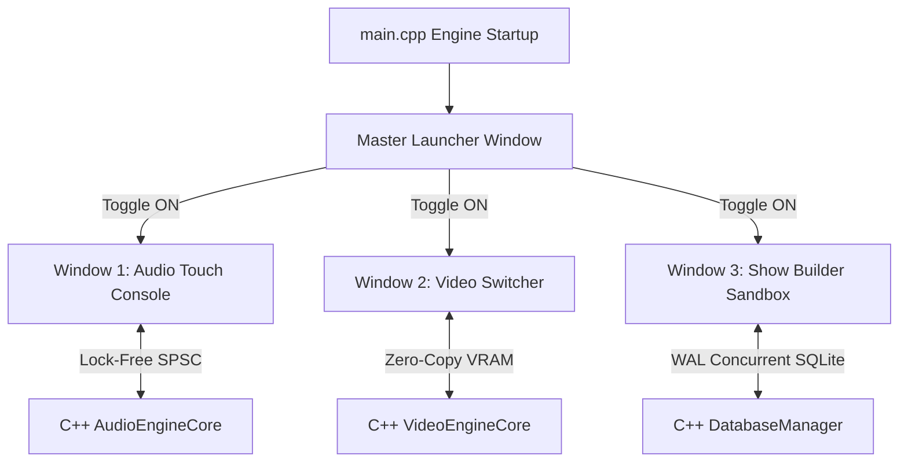

# Specification: Milestone 4 Multi-Window GUI Architecture

This document specifies the UX and window geometry structure for the decoupled, multi-window live production dashboard of Overwatch Studio.

## 1. Architectural Overview & Spawning Lifecycles

Overwatch Studio runs as a **single C++ executable** with three decoupled operating system windows coordinates managed by the central **Master Launcher Window**.

### Window Spawning & Management Details
- **Master Launcher Window:** Coordinates state. Spawns immediately on engine startup at the center of the primary screen. The size is fixed at `360 x 480`.
- **Window 1 (Audio Touch Console):** Initial geometry `800 x 600`, resizable, touch-optimized.
- **Window 2 (Video Switcher):** Initial widescreen geometry `1024 x 576` (16:9 ratio).
- **Window 3 (Show Builder Sandbox):** Spawns as a separate database panel window at `640 x 480`.

---

## 2. Component Specifications

### 2.1. Master Launcher Window (Settings & System Dashboard)
Serves as the main operational pilot cabin of Overwatch Studio.
- **Components:**
  - **Overwatch Header:** Visual green glow, real-time logging monitor status.
  - **Module Controller Buttons:**
    - `Audio Core Module`: Toggle button to open/close/focus the Audio window. Displays a green state light.
    - `Video Switcher Module`: Toggle button to open/close/focus the Video window. Displays a blue state light.
    - `Show Builder Module`: Toggle button to open/close/focus the Show Builder window. Displays a yellow state light.
  - **Watchdog Shedding & Diagnostics Status Box:** Displays CPU warning levels (Level 0 NORMAL, Level 1 UI Throttled, etc.) and active hardware device redirects (ASIO primary / WASAPI fallback) dynamically read from SPSC bridge.
  - **Master Panic Switch (Fade to Black):** Giant, red-glowing Master FTB toggle button. Automatically synchronizes status across all child windows immediately.

### 2.2. Window 1: Audio Core Touch Console
Touch-friendly, high-density fader bay with 48px touch safety padding.
- **Banking Controls:**
  - Column layout on the left containing clickable bank selector blocks:
    - `CH 1 - 4` (Active by default)
    - `CH 5 - 8`
    - `CH 9 - 12`
    - `CH 13 - 16`
    - `CH 17 - 20`
    - `CH 21 - 24`
    - `MASTER`
- **Dynamic 4-Channel Grid:**
  - Displays exactly 4 channel strips representing the active bank.
  - **Fader Slider:** Large vertical touch slider with wide grab handle. Added invisible touch overlays extending hitboxes to `48px` horizontally to protect live finger control.
  - **Peak Level Meter:** Live declarative vertical bar showing peak volume dynamically calculated. Red-glow alert when muted or Panic FTB active.
  - **Mute Button:** Large, square touch button at the top of the fader (red glow when muted).
  - **Linear Rotary Knobs:** Dynamic dials for Input Trim, Gate, Compressor threshold, and EQ band gains with linear vertical-drag behavior.

### 2.3. Window 2: GPU Video Switcher
Side-by-Side layout optimized for widescreen environments.
- **Left Panel (70% Widescreen):**
  - **4-Camera Multiview Grid:**
    - Live drawing grids for Cam 1, Cam 2, Cam 3, Cam 4.
    - Features a continuous scanning line animation on the active Program camera.
    - Red border outline on the camera currently routed to Program (live).
    - Green border outline on the camera currently routed to Preview (next).
- **Right Panel (30% Control Deck):**
  - **Vertical Touch T-Bar Slider:** Large slider mapping transition percentage (0% to 100%).
  - **Auto & Cut Transition Buttons:** Touch keys to trigger automated fades (500ms) or instant hard cuts.
  - **Active Source Readout:** Displays `PGM: CAM X` and `PVW: CAM Y` in glowing boxes.

### 2.4. Window 3: Show Builder Sandbox
Provides show planning database operations in an isolated thread context.
- **Database Loader Panel:** Button to trigger `.sds` file parsing via WAL SQLite delta queues.
- **Transition Transcode Settings:** Checkboxes to select output codecs and slide template dimensions.

---

## 3. Interaction Mechanics & Zero-Allocation Touch Safety
- **T-Bar Transitions:** Dragging the virtual T-Bar posts linear interpolation updates through SPSC queues to D3D11 blend constants without blocking the video thread.
- **Touch Targets:** QML interactive areas for fader rails are padded dynamically using invisible `MouseArea`/`MultiPointTouchArea` handles to reach a strict minimum target boundary of `48px`.

---

## 4. Verification Plan

### Automated Execution
- Build using CMake release target: `overwatch_studio.exe`.
- Verify compilation succeeds with modern MSVC compiler flags.
- Run `ctest --test-dir build` to assert control and audio queues remain 100% stable.

### Manual Verification
1. Launch `overwatch_studio.exe`. Confirm only the **Master Launcher** appears first.
2. Toggle on `Audio Core Module`. Confirm Window 1 spawns correctly with bank controls and 4 faders. Drag sliders and verify logging remains warning-free.
3. Toggle on `Video Switcher Module`. Confirm Window 2 spawns with 4-cam multiview showing running scanning lines. Drag the T-Bar and verify smooth 60fps renders.
4. Engage the `Master FTB (Panic)` button in the Launcher. Verify both Window 1 and Window 2 instantly display blackout/panic mute states.
