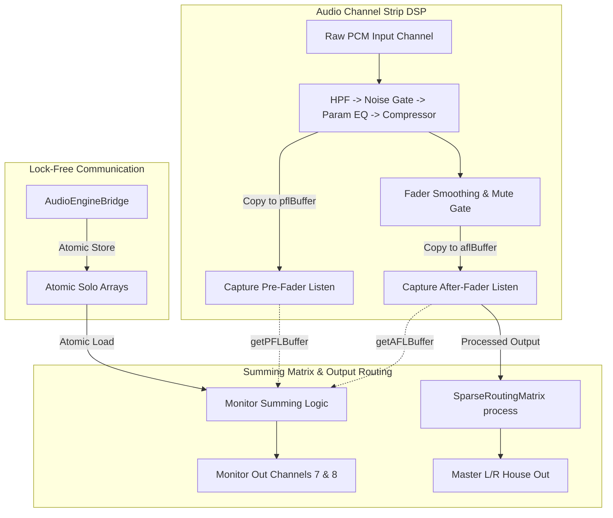

# Low-Latency Non-Destructive Solo (PFL/AFL) Monitor Bus Specification

## 1. Goal Description

Implement a professional-grade, lock-free, zero-allocation **Pre-Fader Listen (PFL)** and **After-Fader Listen (AFL)** monitoring system summed dynamically inside the real-time C++ audio core, synced via atomic registers to a responsive widescreen QML touch console workspace.

The Solo engine operates in **non-destructive Monitor Bus mode (Approach 2)**: soloed signals are summed exclusively onto dedicated physical monitor outputs (Headphones/Monitor wedging, mapped to outputs 7 & 8) while the primary Master L/R house mix remains completely unaffected.

---

## 2. Core Architecture & Signal Flow



### 2.1 Dynamic Tap Point Capture

Each of the 24 channels maintains two pre-allocated, 64-byte aligned buffers sized to handle the maximum real-time block size (1024 samples) cleanly:
*   `pflBuffer`: Captures the signal post-EQ and post-Dynamics, but immediately **prior** to the volume fader gain stage and mute gate triggers.
*   `aflBuffer`: Captures the fully processed signal post-Volume fader gain scaling, post-constant-power panning, and post-Mute.

### 2.2 Real-Time safe Summing Rules

Inside `AudioEngineCore::audioDeviceIOCallbackWithContext`, we track active solo states lock-free:
1.  **If `activeSoloCount == 0`**:
    *   No channels are soloed.
    *   The Stereo Monitor Bus (physical outputs 7 & 8, indices `6` and `7`) dynamically receives a duplicate copy of the Master L/R mix buffer so the engineer hears the full house mix by default.
2.  **If `activeSoloCount > 0`**:
    *   One or more channels are active.
    *   The Monitor Bus clears outputs `6` and `7`, then sums exclusively from active soloed channels:
        *   If `channelSoloModes[c]` is `false` (PFL), sum `getPFLBuffer()` onto output channels `6` and `7` respectively.
        *   If `channelSoloModes[c]` is `true` (AFL), sum `getAFLBuffer()` onto output channels `6` and `7` respectively.

---

## 3. Technical Changes

### 3.1 Audio Core Changes

#### `src/core/audio/AudioChannelStrip.h`
*   Add contiguous stack-allocated buffers:
    ```cpp
    alignas(64) std::array<float, 1024> pflBuffer{};
    alignas(64) std::array<float, 1024> aflBuffer{};
    ```
*   Update `processBlock` to:
    1. Copy post-dynamics samples into `pflBuffer` before fader smoothing / mute gates.
    2. Copy post-fader / mute output samples into `aflBuffer`.
*   Add public getters:
    ```cpp
    const float* getPFLBuffer() const noexcept REALTIME_SAFE { return pflBuffer.data(); }
    const float* getAFLBuffer() const noexcept REALTIME_SAFE { return aflBuffer.data(); }
    ```

#### `src/core/audio/AudioEngineCore.h`
*   Add private atomic states:
    ```cpp
    std::array<std::atomic<bool>, InputChannelsCount> channelSoloStates;
    std::array<std::atomic<bool>, InputChannelsCount> channelSoloModes; // false = PFL, true = AFL
    ```
*   Initialize them to `false` in the constructor.
*   Update `audioDeviceIOCallbackWithContext` to implement the non-destructive Solo routing logic.
*   Expose setters:
    ```cpp
    void setChannelSoloState(size_t chIdx, bool active) noexcept {
        if (chIdx < InputChannelsCount) channelSoloStates[chIdx].store(active, std::memory_order_relaxed);
    }
    void setChannelSoloMode(size_t chIdx, bool isAFL) noexcept {
        if (chIdx < InputChannelsCount) channelSoloModes[chIdx].store(isAFL, std::memory_order_relaxed);
    }
    ```

### 3.2 UI Bridge Changes

#### `src/ui/AudioEngineBridge.h` & `.cpp`
*   Expose properties:
    ```cpp
    Q_PROPERTY(QList<bool> channelSoloStates READ channelSoloStates NOTIFY channelSoloStatesChanged)
    Q_PROPERTY(QList<bool> channelSoloModes READ channelSoloModes NOTIFY channelSoloModesChanged)
    ```
*   Implement invokables:
    ```cpp
    Q_INVOKABLE void updateChannelSoloState(int chIdx, bool active);
    Q_INVOKABLE void updateChannelSoloMode(int chIdx, bool isAFL);
    Q_INVOKABLE void clearAllSolos();
    ```

### 3.3 QML Touch Console Changes

#### `src/ui/Main.qml`
*   **Tactile Solo Buttons**: Add interactive buttons to each channel strip styled in a glowing warm amber (`#FFB300`) with high-contrast text when engaged.
*   **Solo Mode Badges**: Add per-channel badges allowing operators to toggle the monitoring feed of that specific channel strip between PFL and AFL.
*   **Pulse Amber Solo Clear Button**: Add a global `SOLO CLEAR` button in the top status bar. When any solo is active, the button appears, pulsing in amber. Clicking it immediately clears all solo states globally across the mixing console.

---

## 4. Verification Plan

### 4.1 Automated Tests (`tests/AudioEngineTests.cpp`)
*   Add a test case `VerifySoloMonitorBusSumming`:
    1. Instantiate `AudioEngineCore`.
    2. Input a clean continuous-phase 1kHz AC sine wave on Channel 0 and Channel 1.
    3. Assert that without active solos, physical outputs 7 & 8 contain a duplicate copy of the Master output.
    4. Engage Solo on Channel 0 in **PFL mode**. Verify that only Channel 0's pre-fader signal sums to outputs 7 & 8, and muting Channel 0 or pulling down its fader leaves the monitor output unaffected.
    5. Switch Channel 0 to **AFL mode**. Verify that pulling down its fader attenuates the signal on outputs 7 & 8 cleanly.
    6. Engage Solo on Channel 0 and Channel 1 simultaneously, verifying that both sum cleanly to the monitor bus.

### 4.2 Compile and Run Validation
Execute:
```powershell
cmake --build build --config Release
ctest --test-dir build -C Release --output-on-failure
```
Ensure 100% test success and zero real-time heap reallocations.
