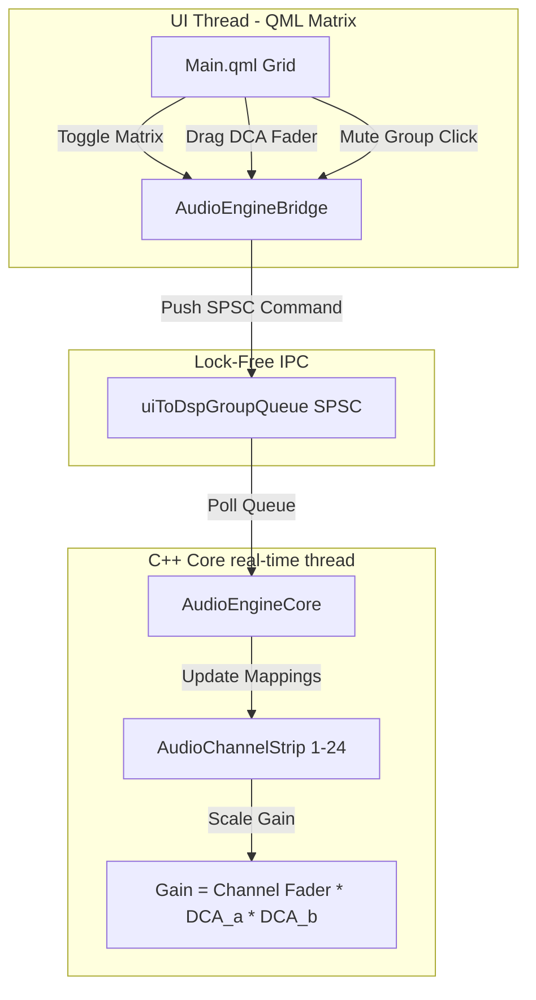

# Design Specification: DCA & Mute Groups Lock-Free DSP Pipeline

This document defines the technical design and architectural boundaries for the **DCA (Digitally Controlled Amplifier) & Mute Groups Integration** in Overwatch Studio, following Milestone 6.

---

## 1. Architectural Overview & Core Data Flow

DCA (Digitally Controlled Amplifier) groups do not sum or route audio themselves; they act as mathematical gain-scaling modifiers inside the real-time DSP processing loop. Mute Groups perform quick-trigger logical OR digital mutes.



### Zero-Allocation Safety & Concurrency
All operations on the real-time thread pool run in $O(1)$ constant time with strictly pre-allocated stack variables. Updates to assignment masks and group gains are pushed from the UI thread via a cache-aligned SPSC queue (`uiToDspGroupQueue`), avoiding locks and preventing priority inversion.

---

## 2. Technical Specification & Data Structures

We will implement the following structures in C++:

### Command Structure
```cpp
struct alignas(64) GroupCommand {
    enum Type {
        DCA_VOLUME,       // Adjust Master DCA Group fader level
        MUTE_GROUP,       // Toggle Master Mute Group state
        DCA_ASSIGNMENT,   // Assign/unassign a channel to/from a DCA Group
        MUTE_ASSIGNMENT   // Assign/unassign a channel to/from a Mute Group
    };

    Type type;
    int groupIndex;       // 0 to 7
    int channelIndex;     // 0 to 23
    float value;          // Volume scale (0.0f - 1.0f) or boolean state (1.0f / 0.0f)
};
```

### Channel DSP Gain Multiplication
Inside `AudioChannelStrip`, we cache thread-local values for `dcaMask` (8-bit bitmask representing which DCAs are active on this channel) and `muteGroupMask` (8-bit bitmask for active Mute Groups).
*   **Active DCA Scaling**:
    $$\text{Gain}_{\text{Channel}} = \text{Fader}_{\text{Channel}} \times \prod_{d \in \text{MappedDCAs}} \text{DCA}_d$$
*   **Active Mute Cascading**:
    $$\text{Muted}_{\text{Channel}} = \text{Mute}_{\text{Channel}} \lor \bigvee_{m \in \text{MappedMuteGroups}} \text{MuteGroup}_m$$

---

## 3. UI/UX & Layout Design

### Tabbed Setup in the Sandbox Window
A new double-tabbed layout inside the **Show Control Sandbox** window will support two views:
1.  **Tab 1: Fail-Safe Diagnostics** (ASIO failover simulators and watchdog telemetry).
2.  **Tab 2: DCA & Mute Matrix** (The new grouping console).
    *   **The Grid Table**: Clean table showing 24 channels (CH 1–24) and 8 DCA + 8 Mute columns. Glassmorphic checkbox cells that glow emerald green (DCA) and cherry red (Mute) when checked.
    *   **Mini Masters Panel**: Renders 8 miniature vertical faders for DCA Groups and 8 Mute Group buttons directly next to the grid.

### Channel Strip Indicator Badges
On the **Audio Touch Console** window, each fader strip displays dynamic, colored pill tags above the vertical level meter:
*   **Green Pills (1-8)**: Indicate active DCA group assignments.
*   **Red Pills (M1-M8)**: Indicate active Mute group assignments.

---

## 4. Verification & Test Plan

### Automated Test Coverage
We will add GoogleTest units inside `tests/ControlEngineTests.cpp`:
*   `DCAGroupGainScaling`: Validates that assigning a channel to DCA 1 (`0.5`) and setting the channel fader to `0.8` scales output gain to exactly `0.4`.
*   `MuteGroupAssignments`: Confirms that activating a mapped Mute Group instantly silences the channel strip output to `0.0`.

### Manual Diagnostic Testing
*   Open the UI dashboard windows.
*   Assign CH 1 to DCA 1. Verify that the indicator badge `1` displays.
*   Drag the DCA 1 master fader down to 50% and verify that output peak activity is scaled accordingly, maintaining relative channel offsets.
