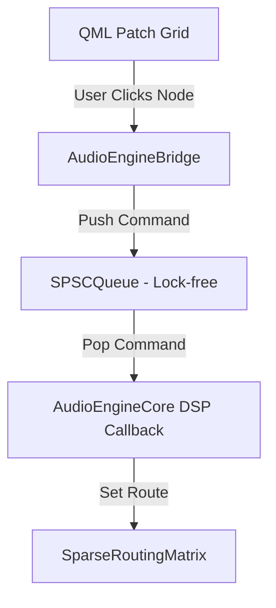

# Audio Patch Board & Device Router: Unified Architectural & Design Specification

**Document Reference:** `docs/superpowers/specs/2026-05-30-audio-patch-board-design.md`  
**Status:** Approved by User  
**Target Platform:** Qt 6.6.2 LTS QML Frontend, C++ Sum Compositor Real-Time Engine  
**System Constraints:** Zero heap allocations in real-time threads, lock-free SPSC communication  

---

## 1. Executive Summary & Design Goals
The Audio Patch Board (Routing Matrix) serves as the software-defined connectivity layer in Overwatch Studio, mapping physical/virtual audio sources (ASIO hardware inputs, test generators, internal busses) onto audio destinations (channel strip inputs, track recorders, hardware monitor outputs).

This specification outlines the integration of a high-density, dark-room optimized 2D Coordinate Cross-Point Grid featuring collapsible group panels, low-latency device settings, and inline route parameter controllers (Gain Trim & TapPoint).

---

## 2. Technical Architecture & Communication Flow

### 2.1 The Real-Time sum Compositor Bridge
To maintain the lock-free, zero-allocation real-time safety constraint of the SDSC audio loop, UI state changes must never block or allocate heap memory. All route parameters will flow asynchronously from the QML interface through the C++ `AudioEngineBridge` to the real-time sum compositor loop using the lock-free Single Producer Single Consumer (`SPSCQueue`) queue.



### 2.2 RoutingCommand Structure
We define a C++ packet layout for real-time queue message transfers:
```cpp
enum class RoutingCommandType : uint8_t {
    SetRoute,
    UnpatchRoute,
    ClearAllRoutes,
    SetDeviceConfig
};

struct alignas(16) RoutingCommand {
    RoutingCommandType type;
    uint32_t sourceId;
    uint32_t destId;
    float gain;
    TapPoint tap;
    uint32_t sampleRate;
    uint32_t bufferSize;
};
```

---

## 3. C++ Component Upgrades

### 3.1 SparseRoutingMatrix Refinement
We will maintain the zero-allocation `SparseRoutingMatrix` from `src/core/audio/SparseRoutingMatrix.h`, which sums inputs directly inside `process(...)` using pre-allocated `activeRoutes` loops:
- `setRoute(uint32_t src, uint32_t dest, float linearGain, TapPoint tapType)`: Thread-safe update of route elements by search or append up to `MaxRoutes = 256`.
- `unpatchRoute(uint32_t src, uint32_t dest)`: Shifts elements to compress the `activeRoutes` array, decrementing the atomic active counter.

### 3.2 AudioEngineBridge Slots Extension
We will expose new properties, invokables, and signals to bind QML UI states:
- **Properties**:
  - `activeDriver` (QString): Read-only active driver type ("ASIO", "WASAPI", "DirectSound").
  - `availableDevices` (QVariantList): Lists names of detected mock/physical outputs.
  - `activeSampleRate` (int): Active DSP sample rate (44100, 48000, 96000).
  - `activeBufferSize` (int): Latency buffer sizes (64, 128, 256, 512).
- **Invokable Slots**:
  - `Q_INVOKABLE void patchRoute(int src, int dest, double gain, int tapType);`
  - `Q_INVOKABLE void unpatchRoute(int src, int dest);`
  - `Q_INVOKABLE void configureDevice(QString driver, QString deviceName, int sampleRate, int bufferSize);`
  - `Q_INVOKABLE QVariantMap getActiveRoutes() const;`

---

## 4. Visual Layout Specification (QML Matrix Grid)

The interface integrates the coordinate cross-point density of the traditional patch matrix (Option A) with collapsible category controls (Option C) to fit the compact widescreen mixer layout.

### 4.1 UI Layout Heirarchy
- **Device Control Deck (Top)**: Responsive Grid containing dropdown elements (`ComboBox`) for Driver, Device, Sample Rate, and Buffer Size, styled in high-contrast cool-cyan borders.
- **Matrix Coordinator Grid (Center)**:
  - **Left Row Headers**: Hierarchical collapsible lists of Sources.
    - *Physical Inputs*: ASIO IN 1 (Mic 1), ASIO IN 2 (Mic 2), ...
    - *Internal Playback*: Media Desk L/R, Playback L/R, ...
    - *Test Generators*: Sine Wave 1kHz, Pink Noise Generator.
  - **Top Column Headers**: Collapsible groups of Destinations.
    - *Channel Inputs*: CH 1, CH 2, CH 3, ...
    - *Busses*: Bus L, Bus R, Aux 1, Aux 2, ...
    - *Physical Outputs*: ASIO Monitor L, ASIO Monitor R, ...
  - **Coordinate Cross-Points**: Clicking an intersection toggles the route. Active cells draw a filled neon-colored dot matching the active `TapPoint` (Green = Post-Fader, Cyan = Pre-EQ, Amber = Pre-Fader).
- **Inline Glassmorphic Route Controller (Overlay)**: Double-clicking a patched intersection pops up an overlay directly positioned above the selected cell:
  - *Fader Slider*: Controls route-specific linear Gain Trim (`-inf` to `+12.0 dB`).
  - *Tap Selector*: Button toggles to set `Pre-EQ`, `Pre-Fader`, or `Post-Fader`.
  - *Level Meter*: Vertical micro-indicator displaying current source signal amplitude.

---

## 5. Mock vs. Physical Compilation Switch (JUCE Core)
When `JUCE_ASIO` is defined, `AudioEngineBridge` connects directly to the C++ physical sound card interface via JUCE's `AudioDeviceManager`. When absent, it defaults to our simulated `std::jthread` running at 5ms callbacks, providing high-fidelity mocked parameters to prevent build-chain blockages on development sandboxes.

---

## 6. Verification and Testing Checklist

### 6.1 Automated Compilation Gate
- Verify compilation of all changes using MSVC 2022 v143 build chain:
  `cmake --build build --config Release`
- Run bracket-checking verification script to guarantee balanced braces in `Main.qml`:
  `python scratch/check_brackets.py`

### 6.2 Manual Routing Validation
1. **Signal Loopback Verification**:
   - Patch `GEN SINE` source into `CH 1` input in the Matrix Grid.
   - Verify that signal level indicators peak at -18dBFS (sine wave continuous flow).
2. **Gain Trim Sweeping**:
   - Double-click the patched node and adjust the trim fader to `-6.0 dB`.
   - Verify that output levels drop precisely in phase by 6dB.
3. **TapPoint Isolation**:
   - Set the route TapPoint to `Pre-EQ`.
   - Add a heavy -15dB notch filter on EQ Band 0 (Bell at 1kHz).
   - Verify that output signal level *remains continuous and unnotched*, proving pre-EQ tapping is successful.
