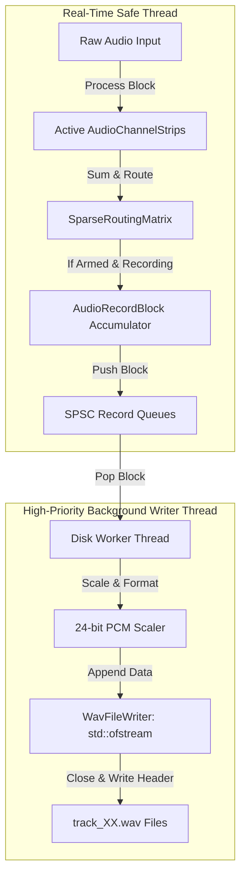

# Design Spec: Dynamic Audio Engine & Low-Latency Asynchronous WAV Recording

This document details the architectural specification for Milestone 11 of Overwatch Studio: supporting fully modular and scalable show fader layouts dynamically, and streaming multitrack PCM audio safely to disk from a background thread pool without ever violating real-time thread safety constraints.

---

## 1. Architectural Blueprint

The audio engine uses **Active Count Masking** over pre-allocated maximum capacity arrays to allow instantaneous layout changes on the fly (e.g. changing from 8 inputs to 64 inputs) without stopping the audio driver.

Multitrack DAW recording is decoupled from the real-time audio thread using Single-Producer Single-Consumer (SPSC) communication queues (`moodycamel::ReaderWriterQueue`), streaming raw audio blocks asynchronously to disk via a high-priority background worker thread.



---

## 2. Dynamic Show Scaling (Active Boundary Masking)

Instead of dynamic resizing on the heap during live production (which causes critical memory allocation spikes and audio pops), `AudioEngineCore` exposes `configureEngine` to update integer active limits on pre-allocated channel pools.

### 2.1 The `configureEngine` Specification
```cpp
void configureEngine(size_t numInputs, size_t numBuses, size_t numAuxes, size_t numDCAs) noexcept {
    // Clamp values to maximum compile-time limits to ensure memory safety
    activeInputsCount = std::min(numInputs, MaxInputs);
    activeBusesCount = std::min(numBuses, MaxBuses);
    activeAuxesCount = std::min(numAuxes, MaxAuxes);
    activeDCAsCount = std::min(numDCAs, MaxDCAs);

    // Dynamic Visual Strip Mapping: first map active inputs, then map active DCAs
    size_t faderIdx = 0;
    for (size_t i = 0; i < activeInputsCount && faderIdx < faderStrips.size(); ++i) {
        faderStrips[faderIdx++] = &channelPool[i];
    }
    
    size_t dcaStartIdx = MaxInputs + MaxBuses + MaxAuxes + MaxFX;
    for (size_t i = 0; i < activeDCAsCount && faderIdx < faderStrips.size(); ++i) {
        faderStrips[faderIdx++] = &channelPool[dcaStartIdx + i];
    }

    // Clear remainder visual strip pointers
    while (faderIdx < faderStrips.size()) {
        faderStrips[faderIdx++] = nullptr;
    }

    // Safely clear sparse routing states
    routingMatrix.clearAllRoutes();
}
```

---

## 3. Asynchronous Multitrack Disk Recording

To stream 24+ channels of raw audio at 24-bit/48kHz without introducing dropouts, we stream uncompressed audio through lock-free SPSC channels to a background pool.

### 3.1 AudioRecordBlock
To minimize queue pushing overhead, samples are grouped into 256-sample blocks before pushing:
```cpp
struct AudioRecordBlock {
    static constexpr size_t BlockSize = 256;
    std::array<float, BlockSize> samples;
    size_t count = 0;
};
```

### 3.2 Lightweight Pure C++ WAV Writer
We implement `WavFileWriter` using standard C++ `std::ofstream` to write high-fidelity 24-bit uncompressed PCM mono files:

```cpp
class WavFileWriter {
public:
    WavFileWriter() = default;
    ~WavFileWriter() { close(); }

    bool open(const std::string& filePath, uint32_t sampleRate) {
        m_file.open(filePath, std::ios::binary);
        if (!m_file.is_open()) return false;
        m_sampleRate = sampleRate;
        m_totalDataBytes = 0;

        // Write a 44-byte placeholder header
        std::vector<char> placeholderHeader(44, 0);
        m_file.write(placeholderHeader.data(), placeholderHeader.size());
        return true;
    }

    void writeSamples(const float* floatSamples, size_t count) {
        if (!m_file.is_open()) return;

        // Scale and pack to professional 24-bit PCM mono (3 bytes per sample)
        std::vector<uint8_t> bytes;
        bytes.reserve(count * 3);

        for (size_t i = 0; i < count; ++i) {
            float clamped = std::max(-1.0f, std::min(1.0f, floatSamples[i]));
            int32_t val = static_cast<int32_t>(clamped * 8388607.0f);
            
            bytes.push_back(static_cast<uint8_t>(val & 0xFF));
            bytes.push_back(static_cast<uint8_t>((val >> 8) & 0xFF));
            bytes.push_back(static_cast<uint8_t>((val >> 16) & 0xFF));
        }

        m_file.write(reinterpret_cast<const char*>(bytes.data()), bytes.size());
        m_totalDataBytes += bytes.size();
    }

    void close() {
        if (!m_file.is_open()) return;

        // Re-write standard RIFF/WAVE header
        m_file.seekp(0);
        uint32_t fileSizeMinus8 = 36 + m_totalDataBytes;
        uint32_t subChunk1Size = 16;
        uint16_t audioFormat = 1; // PCM
        uint16_t numChannels = 1;
        uint16_t bitsPerSample = 24;
        uint16_t blockAlign = 3;
        uint32_t byteRate = m_sampleRate * blockAlign;

        m_file.write("RIFF", 4);
        m_file.write(reinterpret_cast<const char*>(&fileSizeMinus8), 4);
        m_file.write("WAVEfmt ", 8);
        m_file.write(reinterpret_cast<const char*>(&subChunk1Size), 4);
        m_file.write(reinterpret_cast<const char*>(&audioFormat), 2);
        m_file.write(reinterpret_cast<const char*>(&numChannels), 2);
        m_file.write(reinterpret_cast<const char*>(&m_sampleRate), 4);
        m_file.write(reinterpret_cast<const char*>(&byteRate), 4);
        m_file.write(reinterpret_cast<const char*>(&blockAlign), 2);
        m_file.write(reinterpret_cast<const char*>(&bitsPerSample), 2);
        m_file.write("data", 4);
        m_file.write(reinterpret_cast<const char*>(&m_totalDataBytes), 4);

        m_file.close();
    }

private:
    std::ofstream m_file;
    uint32_t m_sampleRate = 48000;
    uint32_t m_totalDataBytes = 0;
};
```

---

## 4. Verification Plan

### 4.1 Headless GoogleTest Coverage
We add automated tests in `tests/DynamicAudioEngineTests.cpp`:
- **Verify Dynamic Reconfiguration:** Verify `configureEngine` sets up mapping pointers properly for arbitrary inputs and DCAs.
- **Verify Bit-Perfect Asynchronous Streaming:** Simulates raw PCM float streams, runs the background recorder, stops, and verifies that the output WAV matches the exact bit-level PCM data written.
